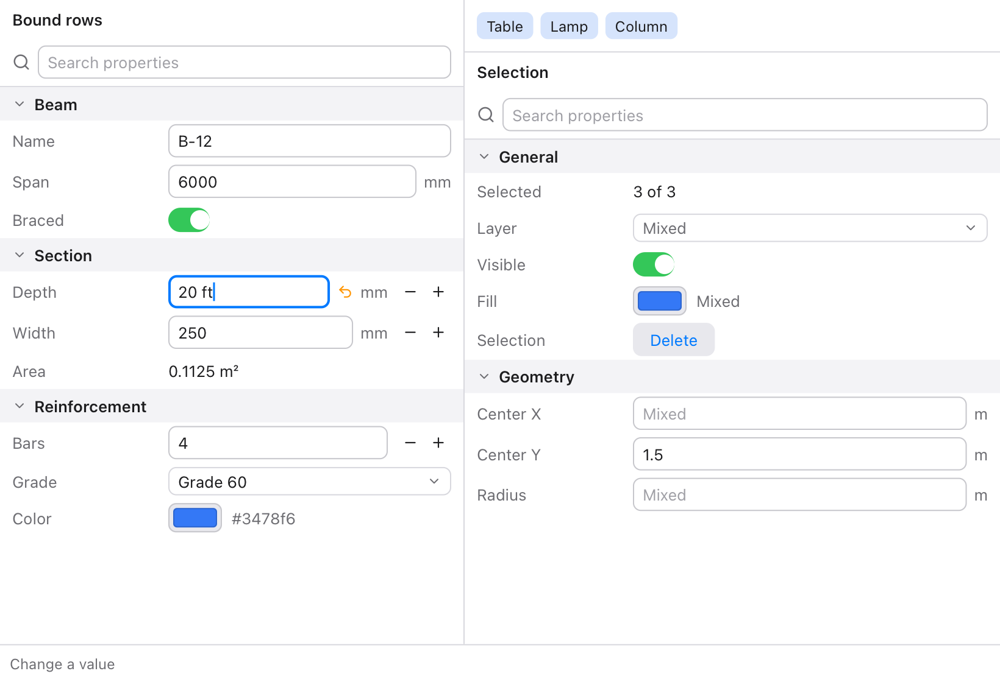
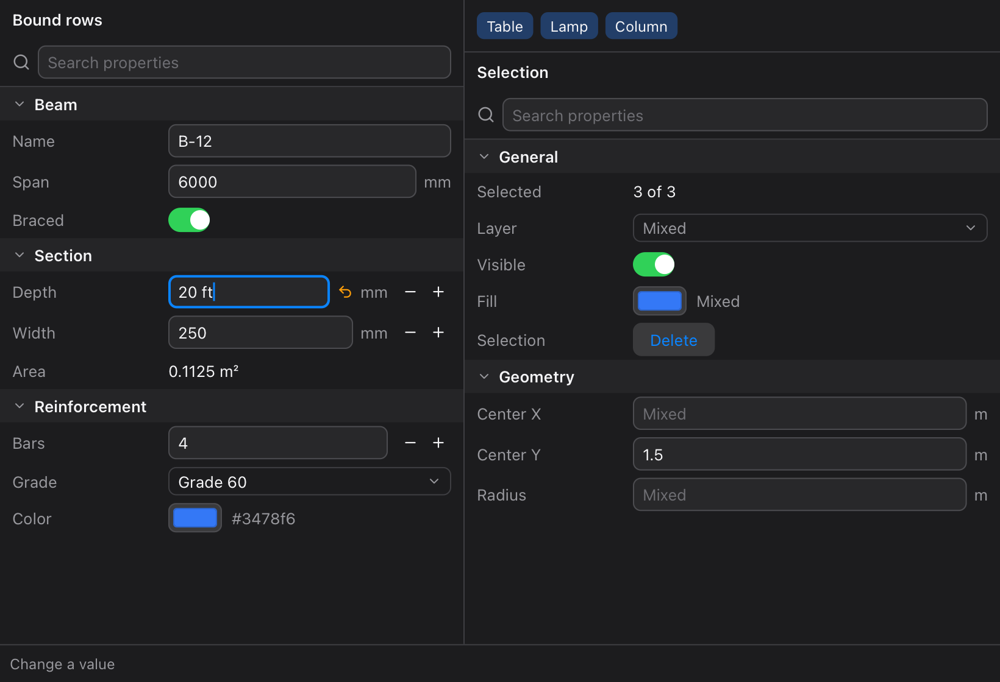

# inspector

Property panels for [Tessel](https://tessel-lang.syncster.dev) apps: the
two-column list of labels and values beside a drawing or a model, as in
CAD and design programs. Number rows take sums and units ("3 ft" in a
field in mm), rows sit in sections that open and close, a search box
finds them, and a panel for a selection shows "Mixed" where the selected
things differ.



There are two ways to make a panel, which look the same:

- **Rows bound to your values**, for a panel that's always the same, like
  the settings of a beam. Each row edits one value directly.
- **An `Inspector` built from a list of properties**, for a panel that
  changes with what's selected. Each change comes back to one function,
  with the property's key and its new value.

```tessel
import inspector

struct Beam {
    span: Float = 6000.0
    depth: Float = 450.0
    grade: String = "Grade 60"
    braced: Bool = true
}

app BeamPanel(width: 380, height: 220) {
    state beam = Beam()

    inspector.Section("Beam") {
        inspector.NumberRow("Span", value: beam.span, unit: "mm", decimals: 0, min: 0.0)
        inspector.NumberRow("Depth", value: beam.depth, unit: "mm", decimals: 0, step: 25.0)
        inspector.ChoiceRow("Grade", selection: beam.grade, options: ["Grade 40", "Grade 60", "Grade 75"])
        inspector.ToggleRow("Braced", isOn: beam.braced)
    }
}
```

Typing `20 ft` in Span and pressing Enter makes `beam.span` 6096.

## Using it

Add it to a project (Tessel 0.10 or later):

```sh
tessel add inspector
```

then `import inspector`. `tessel run examples` in the library's folder
opens the app in the picture.

## Number fields

What's typed in a number field is applied when Enter is pressed. It can
be:

| Typed | In a field in | Gives |
|---|---|---|
| `2*3.5 + 1` | anything | 8 |
| `3 ft` | mm | 914.4 |
| `5'6"` or `5 ft 6 in` | in | 66 |
| `1 m + 50` | mm | 1050 (a plain number is in the field's unit) |
| `100 psi` | kPa | 689.48 |
| `12 kN/m` | N/mm | 12 |
| `68 °F` | °C | 20 |
| `sqrt(16 m²)` | m | 4 |
| `asin(0.5)` | deg | 30 |

- `+ - * / ^` and brackets work, and so do `×`, `·`, `÷` and `−`.
  Functions: `sqrt abs round sin cos tan asin acos atan ln log exp`, and
  `pi`. `sin`, `cos` and `tan` take degrees, as in CAD programs, or an
  angle with its unit (`sin(0.5 rad)`).
- A unit belongs to the number just before it: `pi/2 rad` is
  `pi / (2 rad)`, so write `(pi/2) rad`.
- Something wrong is shown under the field in red, like `this field takes
  a length (mm), not a mass`, and the value doesn't change.
- Until Enter is pressed, an arrow beside the field shows that what's
  typed isn't applied yet. Clicking it goes back to the value. (Tessel 0.10
  tells a library only about Enter, not about each key or a click
  elsewhere, so a field can't apply itself when it's left.)
- `min` and `max` keep the value in bounds. Dragging the label sideways
  changes the value: a `step` per point, or about a hundredth of the value
  with no step. With a `step`, − and + buttons change it by one step.
- `inspector.evaluate(text, unit:)` gives what a field would read, for
  fields of your own, and `inspector.formatNumber(x, decimals:)` shows a
  number as the rows do: `2.5`, `300`, `0.125`.

### Units

| Kind | Units |
|---|---|
| Length | `m km cm mm um µm in ft yd mi nmi`, and `'` `"` for feet and inches |
| Area, volume | any length squared or cubed (`m²`, `ft^2`, `mm2`, `m³`), `ha acre L l mL gal` |
| Mass | `kg g mg t tonne lb oz slug` |
| Time | `s ms min h hr day` |
| Force | `N kN MN lbf kip kgf tf` |
| Pressure, stress | `Pa kPa MPa GPa bar mbar atm psi ksi psf ksf mmHg` |
| Energy, power | `J kJ MJ Wh kWh cal kcal BTU`, `W kW MW hp` |
| Flow, speed | `cfs gpm MGD`, `mph knot kph`, and any combination like `m³/s`, `L/s`, `km/h` |
| Angle | `rad deg ° rev` |
| Temperature | `K °C degC C °F degF F` |
| Other | `Hz % ppm` |

Units combine with `·`, `*`, `/` and powers: `kN·m`, `kN/m²`, `m^3/s`.
A field's `unit` can be any of these. A unit inspector doesn't know
(`"blows/ft"`) is only shown, and the field takes plain numbers. A
temperature in °C or °F is converted on its own, but can't be added to
or multiplied.

## Rows bound to your values

Each row takes its label first, then what it edits. `onChange` runs after
the row changes the value, and is usually the block after the call.

| Row | Edits |
|---|---|
| `NumberRow(label, value:, unit:, decimals:, min:, max:, step:)` | A `Float`. `decimals` is the most shown (4 unless you say). |
| `IntegerRow(label, value:, unit:, min:, max:, step:)` | An `Int`. What's typed is rounded. |
| `TextRow(label, text:)` | A `String`, applied with Enter. |
| `ToggleRow(label, isOn:)` | A `Bool`, with a switch. |
| `ChoiceRow(label, selection:, options:)` | A `String`, one of `options`, picked from a list that opens on a click. |
| `ColorRow(label, color:)` | A `Color`, from Tessel's palette. |
| `InfoRow(label, value)` | Nothing: shows a value, like a result. |
| `ButtonRow(label, title) { … }` | Nothing: a button. |
| `Section(title, expanded:) { … }` | A heading that opens and closes the rows in it. |
| `SearchBox(text:)` | A search field. |

Every row also takes `readOnly:`, `labelWidth:` (120 unless you say),
`help:` (shown when the mouse rests on the label) and `filter:`. Give the
rows a `SearchBox`'s text as their `filter`, and only the rows whose label
has it show:

```tessel
state query = ""

inspector.SearchBox(text: query)
inspector.Section("Section") {
    inspector.NumberRow("Depth", value: beam.depth, unit: "mm", filter: query)
    inspector.NumberRow("Width", value: beam.width, unit: "mm", filter: query)
}
```

(A `Section` stays when none of its rows match. The `Inspector` hides
groups with nothing to show.)

## An Inspector built from properties

`Inspector(properties:, title:, search:, labelWidth:, emptyText:) { key, value in … }`
shows a list of properties under a heading for each group, with a search
box over them that matches labels and group names. It scrolls when it's
taller than its space. Make the properties from your data each time the
view is built; a change calls the block with the property's key and its
new `Value`, and once your data changes, the panel shows it.

| Property | Comes back as |
|---|---|
| `inspector.number(key, label, value, unit:, decimals:, min:, max:, step:)` | `.number(x)` |
| `inspector.integer(key, label, value, unit:, min:, max:, step:)` | `.number(x)`, a whole number |
| `inspector.text(key, label, value)` | `.text(s)` |
| `inspector.toggle(key, label, on)` | `.toggle(on)` |
| `inspector.choice(key, label, value, options)` | `.text(option)` |
| `inspector.color(key, label, color)` | `.color(c)` |
| `inspector.info(key, label, value)` | (read only) |
| `inspector.action(key, label, title)` | `.pressed` |

Each also takes `group:`, `readOnly:`, `mixed:` and `help:`. With
`mixed: true`, the row shows "Mixed" instead of the value: for a selection
whose things differ there. A value typed or picked in a mixed row comes
back as usual, for you to give to all of them.

```tessel
inspector.Inspector(properties: [
    inspector.info("count", "Selected", "{picked.count} shapes", group: "General"),
    inspector.choice("layer", "Layer", first.layer, layers, group: "General", mixed: !sameLayer),
    inspector.number("r", "Radius", first.radius, unit: "m", min: 0.0, group: "Geometry", mixed: !sameRadius),
    inspector.action("delete", "Selection", "Delete", group: "General"),
]) { key, value in
    match value {
        .number(x) -> { for k in selected { if key == "r" { shapes[k].radius = x } } }
        .text(s) -> { for k in selected { if key == "layer" { shapes[k].layer = s } } }
        .pressed -> deleteSelected()
        _ -> {}
    }
}
```

The whole example, with a selection of shapes, is `examples/main.tsl`.

## Light and dark

The panels use Tessel's adaptive colors, so they follow the system's
appearance:



## Tests

```sh
tessel run tests     # what number fields read, against values worked out in Python
sh tests/ui.sh       # the example app driven without a window: 34 checks
```

`tests/ui.sh` types, clicks, drags and searches in the example app with a
`TESSEL_SCRIPT`, and checks the rows afterwards: units converted, bounds
kept, mistakes shown, choices, switches, colors, search, sections, and
the Inspector's mixed values.

## What's where

| File | |
|---|---|
| `rows.tsl` | The rows, `Section`, `SearchBox`, and the views that draw each kind of row. |
| `inspector.tsl` | `Inspector`, `Property`, `Kind`, `Value`, and `number`, `choice` and the other property makers. |
| `expr.tsl` | `evaluate` and `formatNumber`: what's typed in a number field. |
| `units.tsl` | The units and their dimensions. |
| `examples/main.tsl` | The app in the pictures. |
| `tests/` | The tests. |

## Licence

MIT: see [LICENSE](LICENSE).
